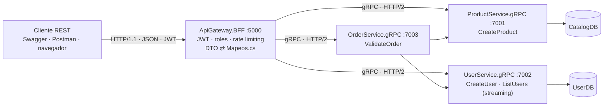

# ECommerceGRPC · Tarea 1 · Arquitectura híbrida REST/gRPC con JWT

El gateway **ApiGateway.BFF** expone REST hacia afuera y habla gRPC hacia adentro. Esta tarea le agrega tres endpoints que responden desde dos servicios gRPC que ya existían (Productos y Usuarios), sin tocar ningún `.proto` ni ningún servicio gRPC.

## Integrantes

| # | Nombre | Carné |
|---|--------|-------|
| 1 | Hubert Hernández Gutiérrez  | _(completar)_ |
| 1 | Minor Quesada Grosso  | _7435_ |
| 1 | William Vargas Morales  | _8937_ |

## Diagrama



## Cómo levantar el sistema

Requisitos: Docker Desktop y, para correr la colección desde consola, Node.js (opcional).

```bash
cd Infrastructure
docker compose up -d --build     # siempre con --build
docker compose ps                # deben aparecer los siete servicios
```

| Servicio | Puerto en la máquina |
|----------|----------------------|
| Gateway REST + Swagger | `http://localhost:5000/swagger` |
| Productos gRPC | 7001 |
| Usuarios gRPC | 7002 |
| Pedidos gRPC | 7003 |
| Catálogo REST (Nivel 1) | 5001 |
| Usuarios REST (Nivel 1) | 5002 |
| SQL Server | 1434 |

Para apagar: `docker compose down`.

## Usuarios de prueba

| Correo | Clave | Rol |
|--------|-------|-----|
| `admin@example.com` | `Admin2026!` | Admin |
| `user@example.com` | `Cliente2026!` | Cliente |

Se obtiene el token con `POST /api/auth/login` y se envía como `Authorization: Bearer <token>`. En Swagger se pega solo el token en el botón **Authorize**.

## Los tres endpoints

| # | Endpoint | Llama a (gRPC) | Quién puede | Respuestas | Rate limiting |
|---|----------|----------------|-------------|------------|---------------|
| 1 | `POST /api/v1/productos` | `ProductService.CreateProduct` | Rol Admin | 201 · 400 · 401 · 403 · 409 · 429 | `escrituras`: 3 cada 30 s por usuario |
| 2 | `POST /api/v1/usuarios/registro` | `UserService.CreateUser` | Cualquiera, sin token | 201 · 400 · 409 · 429 | `login`: 10 por minuto por IP |
| 3 | `GET /api/v1/usuarios` | `UserService.ListUsers` (server streaming) | Rol Admin | 200 · 401 · 403 · 429 | `lecturas`: 10 cada 10 s por IP |

Los códigos de error los traduce `RpcExceptionHandler`: `InvalidArgument` → 400, `AlreadyExists` → 409, `Unavailable` → 503. Cuando se excede una política responde 429 con el encabezado `Retry-After`.

### 1. Crear producto (Admin)

```http
POST /api/v1/productos
Authorization: Bearer <token de Admin>
Content-Type: application/json

{
  "nombre": "Mouse Swagger 01",
  "descripcion": "Creado desde Swagger UI",
  "precio": 25.5,
  "stock": 40,
  "categoria": "Perifericos"
}
```

```http
HTTP/1.1 201 Created
Location: http://localhost:5000/api/v1/productos/5

{
  "id": 5,
  "nombre": "Mouse Swagger 01",
  "descripcion": "Creado desde Swagger UI",
  "precio": 25.5,
  "categoria": "Perifericos",
  "stock": 40,
  "disponible": true
}
```

Errores: `400` (precio ≤ 0, falta nombre o categoría), `401` (sin token), `403` (token de Cliente), `409` (ya existe un producto con ese nombre).

### 2. Registrar usuario (sin token)

```http
POST /api/v1/usuarios/registro
Content-Type: application/json

{
  "email": "maria.swagger@example.com",
  "nombre": "Maria",
  "apellido": "Lopez",
  "clave": "Clave2026!"
}
```

```http
HTTP/1.1 201 Created
Location: http://localhost:5000/api/v1/usuarios/4

{
  "id": 4,
  "email": "maria.swagger@example.com",
  "nombreCompleto": "Maria Lopez",
  "activo": true,
  "creadoEl": "2026-11-13T06:23:25.1339151Z"
}
```

Errores: `400` (clave de menos de 8 caracteres o datos vacíos), `409` (correo ya registrado). La clave nunca se devuelve; el servicio gRPC guarda solo su hash BCrypt.

### 3. Listar usuarios (Admin)

```http
GET /api/v1/usuarios
Authorization: Bearer <token de Admin>
```

```http
HTTP/1.1 200 OK

[
  { "id": 1, "email": "admin@example.com", "nombreCompleto": "Admin System", "activo": true, "creadoEl": "2026-09-14T00:00:00Z" },
  { "id": 2, "email": "user@example.com",  "nombreCompleto": "John Doe",     "activo": true, "creadoEl": "2026-09-14T00:00:00Z" }
]
```

Por dentro `ListUsers` es server streaming: el gateway junta los mensajes y devuelve una lista JSON. Errores: `401` (sin token), `403` (token de Cliente).

## Estructura del código

| Pieza | Ubicación |
|-------|-----------|
| DTO de solicitud (`CrearProductoDto`, `RegistroDto`) | `ApiGateway.BFF/Modelos/Dtos.cs` |
| Transformaciones DTO → mensaje gRPC (`decimal` → `double`) | `ApiGateway.BFF/Modelos/Mapeos.cs` |
| Endpoints de productos | `ApiGateway.BFF/Controllers/ProductosController.cs` |
| Endpoints de usuarios | `ApiGateway.BFF/Controllers/UsuariosController.cs` |
| Clientes gRPC por inyección de dependencias, rate limiting, JWT | `ApiGateway.BFF/Program.cs` |
| Traducción de errores gRPC → HTTP | `ApiGateway.BFF/Errores/RpcExceptionHandler.cs` |

Ningún controlador arma un mensaje gRPC a mano: todo pasa por `Mapeos`.

## Pruebas con Postman

Importar `Postman/ECommerceGRPC_Clase2.postman_collection.json` y ejecutar **Run collection** con la variable `baseUrl = http://localhost:5000`. La carpeta **6 · Tarea 1** tiene una prueba por cada respuesta de la tabla. Antes de la cuarta escritura espera 31 s (`setTimeout(() => {}, 31000)`) para respetar la política `escrituras`.

Desde consola:

```bash
npx newman run Postman/ECommerceGRPC_Clase2.postman_collection.json
```

## Resiliencia: servicio interno caído

```bash
docker compose stop order-grpc     # apagar Pedidos
# POST /api/v1/pedidos/validar  → 503 "Un servicio interno no responde."
# El resto de los endpoints sigue respondiendo con normalidad.
docker compose start order-grpc    # volver a encenderlo
```
